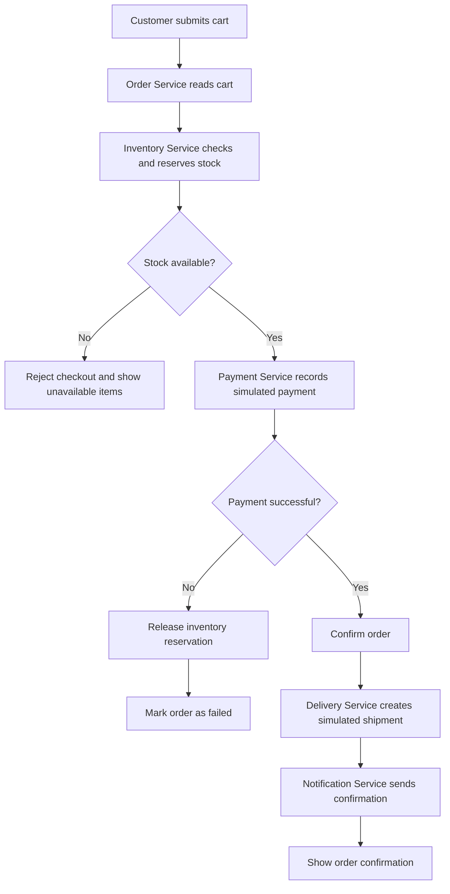

# Checkout Activity Diagram

## Decision outcomes

- If stock is unavailable, checkout stops before payment.
- If simulated payment fails, the reservation is released and the order is marked failed.
- If payment succeeds, the order is confirmed and delivery and notification steps follow.
